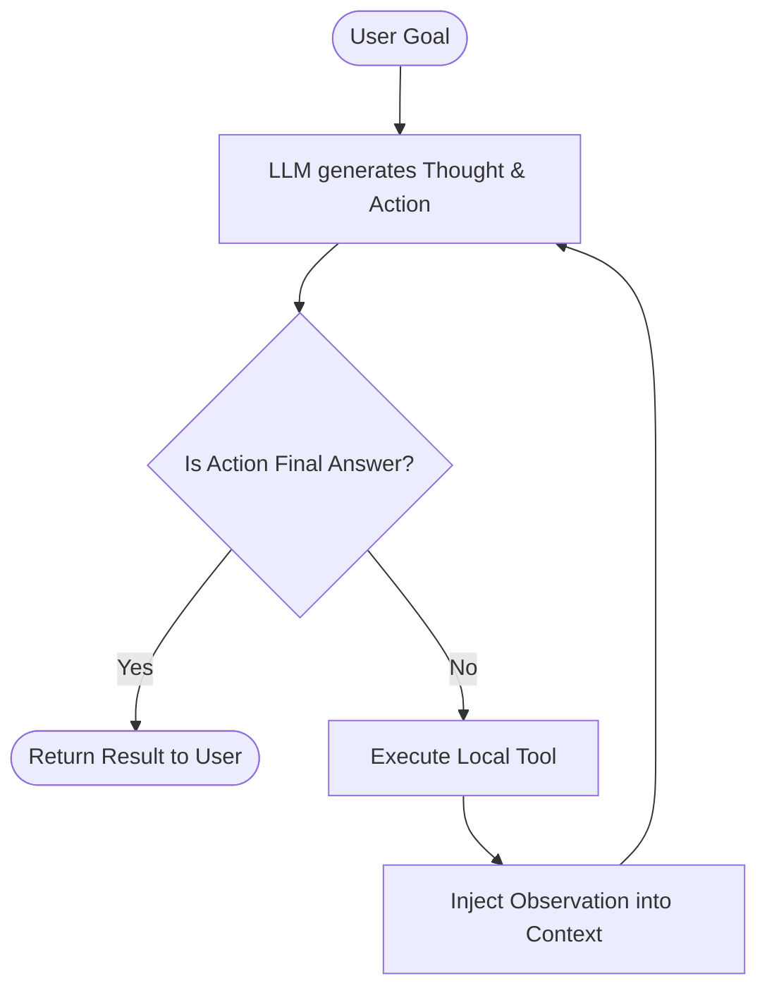

# 🧠 Micro-Agents

> **Build production-grade AI agents from scratch in <100 lines of clean code.**  
> *No LangChain. No bloated abstractions. No dependency hell. Just first principles.*

[](LICENSE)
[](https://www.python.org/)
[](CONTRIBUTING.md)
[](#why)

---

## ⚡ The Problem: "Framework Fatigue"

Modern agent frameworks often bundle hundreds of opaque classes, obscure prompt wrappers, and breaking changes every minor release. 

When your agent fails in production at 2 AM, debugging an 18-layer call stack inside a third-party abstraction is painful.

**The secret the AI industry won't tell you:**  
An autonomous agent is just:
```
LLM Output + Structured Schema + Tool Execution + While Loop
```

This repository contains **minimal, crystal-clear, production-tested patterns** showing how to implement every core agentic architecture in **pure, readable Python** using standard libraries and standard API payloads.

---

## 🗺️ Architectural Cheat Sheet

| Pattern | Lines of Code | Description | Recipe |
| :--- | :--- | :--- | :--- |
| **01. Tool-Calling Agent** | ~60 lines | Function calling & schema execution in a clean loop | [`recipes/01_single_loop_tool_caller.py`](recipes/01_single_loop_tool_caller.py) |
| **02. ReAct Loop** | ~75 lines | Thought $\to$ Action $\to$ Observation cycle | [`recipes/02_react_agent.py`](recipes/02_react_agent.py) |
| **03. Plan-and-Execute** | ~85 lines | Decomposes complex objectives into subtasks | [`recipes/03_plan_and_execute.py`](recipes/03_plan_and_execute.py) |
| **04. Self-Reflection & Fix** | ~70 lines | Generates code, tests it, inspects errors, auto-fixes | [`recipes/04_self_reflection_agent.py`](recipes/04_self_reflection_agent.py) |
| **05. Multi-Agent Team** | ~95 lines | Supervisor routes tasks between Researcher & Writer | [`recipes/05_multi_agent_team.py`](recipes/05_multi_agent_team.py) |

---

---

## 🛠️ Installation & Step-by-Step Usage Guide

### Prerequisites
- Python 3.10 or higher (`python --version`)
- Standard terminal (PowerShell, Bash, or Zsh)
- *(Optional)* An API key from OpenAI, DeepSeek, Groq, or a locally running Ollama instance.

---

### Step 1: Clone the Repository
Clone `micro-agents` to your local machine:

```bash
git clone https://github.com/builder-505/micro-agents.git
cd micro-agents
```

---

### Step 2: (Optional) Create a Virtual Environment
Keep your environment clean using Python's built-in `venv`:

```bash
# On Linux / macOS:
python3 -m venv .venv
source .venv/bin/activate

# On Windows (PowerShell):
python -m venv .venv
.venv\Scripts\Activate.ps1
```

*(No external pip dependencies are required — the entire project runs on Python standard library!)*

---

### Step 3: Run Instantly in Offline Simulation Mode (No API Key Required!)
You can immediately test any agent architecture out-of-the-box. Every recipe includes simulated responses so you can observe the internal reasoning loop:

```bash
# 1. Run the Tool Caller:
python recipes/01_single_loop_tool_caller.py

# 2. Run the ReAct Reasoning Agent:
python recipes/02_react_agent.py

# 3. Run the Plan-and-Execute Agent:
python recipes/03_plan_and_execute.py

# 4. Run the Code Auto-Healing Agent:
python recipes/04_self_reflection_agent.py

# 5. Run the Multi-Agent Team:
python recipes/05_multi_agent_team.py
```

---

### Step 4: Connecting a Real LLM Provider
To switch from offline simulation to live LLM execution, simply set your environment variable:

#### Option A: OpenAI
```bash
# Linux / macOS
export OPENAI_API_KEY="sk-..."

# Windows PowerShell
$env:OPENAI_API_KEY="sk-..."
```

#### Option B: DeepSeek / Groq / Local Ollama (Zero Cost)
All recipes use standard OpenAI-compatible completions. To point to Ollama or DeepSeek:

```bash
# Example with Local Ollama:
export OPENAI_BASE_URL="http://localhost:11434/v1"
export OPENAI_API_KEY="ollama"

# Example with DeepSeek:
export OPENAI_BASE_URL="https://api.deepseek.com/v1"
export OPENAI_API_KEY="your-deepseek-key"
```

---

### Step 5: How to Use in Your Own Project

Because `micro-agents` recipes are single-file architectures with zero external framework wrappers, you can drop them straight into your own codebase:

1. **Copy the recipe file** you need into your project (e.g., `cp recipes/01_single_loop_tool_caller.py ./my_agent.py`).
2. **Add your own custom tools** as standard Python functions:
```python
def check_order_status(order_id: str) -> str:
    # Your database query here
    return json.dumps({"order_id": order_id, "status": "Shipped"})

# Register in the tool dictionary:
AVAILABLE_TOOLS["check_order_status"] = check_order_status
```
3. Run `run_agent_loop("Where is order #9921?")` — that's it!

---

## 🔍 Visual Workflow: ReAct Pattern



---

## 📦 What's Inside?

### 1. `01_single_loop_tool_caller.py`
Demonstrates how LLM tool calling actually works under the hood. Parses JSON tool arguments, routes to a real Python function, and returns the result back to the model.

### 2. `02_react_agent.py`
Implements the classic Yao et al. **ReAct** (Reasoning + Acting) loop without external dependencies. Watch the agent think aloud, query tools, and reason to conclusions.

### 3. `03_plan_and_execute.py`
Separates **planning** from **execution**. The planner generates a structured DAG/step list, and an executor carries out each step while updating the blackboard state.

### 4. `04_self_reflection_agent.py`
An agent that writes code, runs it in an isolated subprocess, catches stderr/exceptions, passes the error back to itself, and iteratively self-corrects until tests pass.

### 5. `05_multi_agent_team.py`
A lightweight supervisor pattern where an orchestrator agent directs a domain researcher and a technical writer, synthesizing a comprehensive response.

---

## 💡 Guiding Principles

1. **No Magic**: If it can be done with a standard `dict` or `list`, we do not create a custom class.
2. **Provider Agnostic**: Written with simple standard HTTP requests / standard payloads. Works with OpenAI, Claude, DeepSeek, Mistral, Ollama, and local vLLM.
3. **Copy-Paste Ready**: Every single recipe is self-contained in one file. Copy the file into your codebase and start building.

---

## 🤝 Contributing

We welcome new micro-agent recipes! Whether it's:
- Human-in-the-loop approval workflows
- Structured evaluation gates
- Vectorless associative memory
- TypeScript / Go ports

Check out [CONTRIBUTING.md](CONTRIBUTING.md) to get started.

---

## ⭐ Star History

If you found this useful, drop a star! It keeps the motivation high to add more recipes.

[](https://star-history.com/#builder-505/micro-agents&Date)

---

## ☕ Support & Donations

If `micro-agents` helped you learn, saved you engineering hours, or inspired your architecture, consider supporting open-source development:

| Network | Asset | Address |
| :--- | :--- | :--- |
| **Bitcoin** | `BTC` | `bc1q62yn8mm5rty7x9fvq92p420eysxsyysk6klt7y` |
| **Ethereum** | `ETH` / `ERC-20` | `0x83B7ea465C7b9CE1BaCf2c8ad538Cc6b55aa1a2c` |
| **BNB Smart Chain** | `BNB` / `BEP-20` | `0x83B7ea465C7b9CE1BaCf2c8ad538Cc6b55aa1a2c` |

Thank you for supporting independent open-source software! 🚀

---

## 📄 License

MIT License — Feel free to use in personal, educational, or commercial projects without restriction.
